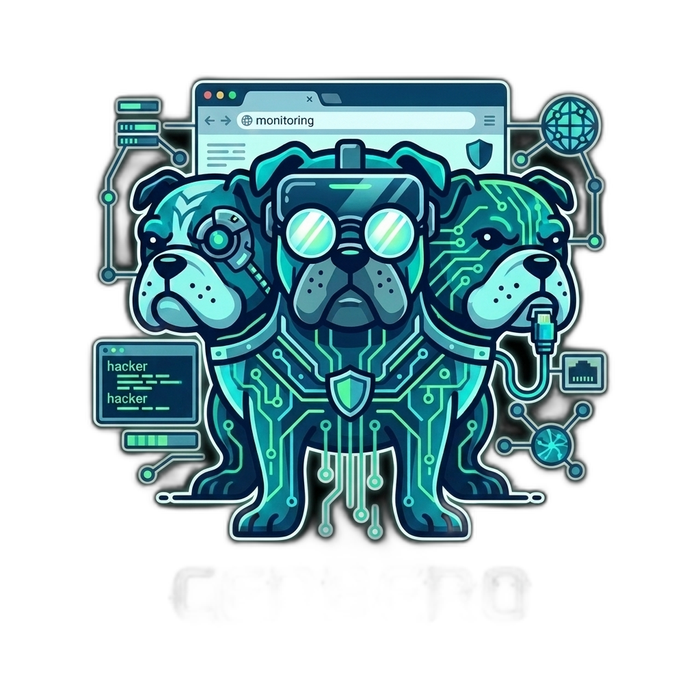

<div align="center">
  <a href="https://github.com/thecreazy/cerbero">
    
  </a>
  <br>
  <br>
</div>

[![npm][npm]][npm-url]
[![codecov][codecov]][repo-url] [![CI - Test][citest]][repo-url]
[![GitHub license][githublicense]][license-url] [![Open Source Love svg1][opensource]][opensource-url]

# 🐾 Cerbero

Cerbero is a lightweight TypeScript library for tracking user interactions in the browser. It collects **clicks, scrolls, text selections, mouse exits, time on page, performance metrics, Web Vitals, and many more signals** — and offloads all processing to a **Web Worker** so the main thread stays free.

> **[→ Live Demo](https://thecreazy.github.io/cerbero/)** — see every event type and every plugin in action.

## Table of Contents

1. [Install](#install)
2. [Quick Start](#quick-start)
3. [Constructor Options](#constructor-options)
4. [Public API](#public-api)
5. [Event Reference](#event-reference)
6. [Plugin System](#plugin-system)
7. [Selective Tracking](#selective-tracking)
8. [Batching](#batching)
9. [Breaking Changes from v1.x](#breaking-changes-from-v1x)
10. [Contributing](#contributing)
11. [License](#license)

---

## Install

```bash
npm install cerbero
# or
yarn add cerbero
```

CDN (UMD, no bundler needed):

```html
<script src="https://unpkg.com/cerbero/dist/cerbero.umd.js"></script>
<!-- window.cerbero.Cerbero is now available -->
```

---

## Quick Start

```typescript
import { Cerbero } from 'cerbero';

const cerbero = new Cerbero();

cerbero.addEventListener((event) => {
  console.log(event.type, event.data);
});
```

---

## Constructor Options

```typescript
new Cerbero(config?: CerberoConfig)
```

| Option | Type | Default | Description |
|--------|------|---------|-------------|
| `events` | `string[]` | *(all)* | Whitelist of event types to track. Omit to track everything. |
| `domPath` | `boolean` | `false` | Include full DOM ancestor path in serialized elements (e.g. `> html > body > div > button`). Results are cached per-element via WeakMap. |
| `domPosition` | `boolean` | `false` | Include element bounding box via `getBoundingClientRect()`. Forces a synchronous layout reflow on every event. |
| `batchSize` | `number` | — | Flush callback when N events have accumulated. |
| `batchInterval` | `number` | — | Flush callback every N milliseconds. |

```typescript
const cerbero = new Cerbero({
  events: ['click', 'scroll', 'webVitals'],
  domPath: true,
  batchSize: 10,
});
```

---

## Public API

### `addEventListener(callback)`

Register the callback that receives every event (or batch).

```typescript
cerbero.addEventListener((event) => {
  // event is a single object (or unknown[] if batching is enabled)
  sendToMyBackend(event);
});
```

### `setTimeInPageInterval(ms)`

Change how often the `timeInPage` event fires. Default: `2500` ms.

```typescript
cerbero.setTimeInPageInterval(5000);
```

### `observeElements(selector)`

Track element visibility via `IntersectionObserver`. Fires an `elementVisible` event when a matching element is ≥50% in the viewport.

```typescript
cerbero.observeElements('.hero-cta, .pricing-card');
```

### `use(plugin)`

Register a plugin that emits custom events through the Cerbero pipeline. Returns `this` for chaining.

```typescript
import { fingerprintPlugin } from './plugins/fingerprint';

cerbero.use(fingerprintPlugin());
```

### `destroy()`

Remove all event listeners, disconnect observers, clear intervals, and terminate the Web Worker.

```typescript
cerbero.destroy();
```

---

## Event Reference

All events share a base shape:

```json
{
  "type": "click",
  "time": 1720000000000,
  "after": 1234,
  "data": { ... }
}
```

- `time` — Unix timestamp (ms) when the event was processed
- `after` — ms elapsed since page load
- `data` — event-specific payload

---

### `click`

Fires on every pointer-up (`pointerup` event, capturing mouse, touch, and pen input).

```json
{
  "type": "click",
  "data": {
    "position": { "screenX": 752, "screenY": 244, "clientX": 752, "clientY": 164,
                  "pageX": 752, "pageY": 3609, "x": 752, "y": 164,
                  "offsetX": 388, "offsetY": 414 },
    "keys": { "ctrlKey": false, "shiftKey": false, "altKey": false, "metaKey": false },
    "pointerType": "mouse",
    "elements": {
      "target": { "id": "", "type": "BUTTON", "domType": "HTMLButtonElement",
                  "identifier": "button#submit", "className": "btn-primary" }
    }
  }
}
```

---

### `rageClick`

Fires when the same element is clicked 3+ times within 500 ms.

```json
{
  "type": "rageClick",
  "data": {
    "count": 4,
    "target": { "identifier": "button#submit", "domType": "HTMLButtonElement" }
  }
}
```

---

### `scroll`

Fires once per scroll stop (debounced at 100 ms).

```json
{
  "type": "scroll",
  "data": {
    "scroll": { "fromTop": 1240, "domHeight": 5800, "percentage": 21.37 }
  }
}
```

---

### `mouseExit`

Fires when the pointer leaves the browser window.

```json
{
  "type": "mouseExit",
  "data": {
    "position": { "screenX": 744, "screenY": 0, "clientX": 744, "clientY": 0,
                  "pageX": 744, "pageY": 820, "x": 744, "y": 0 },
    "keys": { "ctrlKey": false, "shiftKey": false, "altKey": false, "metaKey": false },
    "elements": {
      "target": { "id": "hero", "type": "DIV", "domType": "HTMLDivElement", "identifier": "div#hero" }
    }
  }
}
```

---

### `selection`

Fires when the user finishes a text selection.

```json
{
  "type": "selection",
  "data": {
    "text": "the selected text string",
    "elements": {
      "anchorNode": { "type": "#text", "data": "full text of node", "offset": 4 },
      "focusNode":  { "type": "#text", "data": "full text of node", "offset": 22 }
    }
  }
}
```

---

### `timeInPage`

Fires on a repeating interval (default 2.5 s). Pauses automatically when the tab is hidden (Page Visibility API).

```json
{
  "type": "timeInPage",
  "data": { "timePassed": 7500 }
}
```

---

### `performance`

One-shot at page load. Uses `PerformanceNavigationTiming` (via `PerformanceObserver`).

```json
{
  "type": "performance",
  "data": {
    "timing": {
      "domContentLoadedEventEnd": 312.4,
      "loadEventEnd": 541.8,
      "responseStart": 84.2,
      "responseEnd": 190.1,
      "domInteractive": 295.0
    }
  }
}
```

---

### `webVitals`

Fires for each Core Web Vital as it becomes available: CLS, FCP, INP, LCP, TTFB.

```json
{
  "type": "webVitals",
  "data": {
    "name": "LCP",
    "value": 1842.5,
    "rating": "good",
    "delta": 1842.5,
    "id": "v3-1720000000000-1234"
  }
}
```

---

### `environment`

One-shot at init. Rich device and session context.

```json
{
  "type": "environment",
  "data": {
    "darkMode": true,
    "reducedMotion": false,
    "colorGamut": "p3",
    "cpuCores": 10,
    "deviceMemory": 8,
    "devicePixelRatio": 2,
    "screenWidth": 2560,
    "screenHeight": 1440,
    "viewportWidth": 1440,
    "viewportHeight": 900,
    "pointerType": "mouse",
    "hasHover": true,
    "maxTouchPoints": 0,
    "language": "en-US",
    "languages": ["en-US", "it-IT"],
    "timezone": "Europe/Rome",
    "hourCycle": "h23",
    "referrer": "https://google.com",
    "historyLength": 3,
    "isIframe": false,
    "isStandalone": false,
    "serviceWorker": true,
    "webAssembly": true
  }
}
```

---

### `network`

Fires at init and again on connection change. Requires `navigator.connection` (Chrome/Edge).

```json
{
  "type": "network",
  "data": { "effectiveType": "4g", "downlink": 10, "rtt": 50, "saveData": false }
}
```

---

### `longTask`

Fires for every main-thread task exceeding 50 ms. Requires `longtask` PerformanceObserver support (Chrome/Edge).

```json
{
  "type": "longTask",
  "data": { "duration": 87.3, "startTime": 1234.5 }
}
```

---

### `slowResource`

Fires when a network resource takes more than 1 000 ms to load.

```json
{
  "type": "slowResource",
  "data": {
    "name": "https://example.com/large-image.jpg",
    "duration": 1842,
    "initiatorType": "img",
    "startTime": 400.2
  }
}
```

---

### `browserAI`

One-shot detection of browser AI APIs (Chrome 127+). Never invokes the model.

```json
{
  "type": "browserAI",
  "data": { "hasChromeAI": true, "chromeAIModel": "readily", "hasWebNN": false }
}
```

---

### `privacySignals`

Fires first, before any other listener is set up. If `gpc === true` (Global Privacy Control), Cerbero calls `destroy()` and emits no further events.

```json
{
  "type": "privacySignals",
  "data": { "gpc": false, "doNotTrack": false, "gpcAutoDisabled": false }
}
```

---

### `orientationChange`

Fires when the screen orientation changes (mobile/tablet).

```json
{
  "type": "orientationChange",
  "data": { "orientationType": "landscape-primary", "angle": 90 }
}
```

---

### `elementVisible`

Fires when an observed element enters the viewport (≥50% visible). Requires a call to `observeElements()`.

```json
{
  "type": "elementVisible",
  "data": { "selector": ".hero-cta", "visibleRatio": 0.82,
            "element": { "identifier": "div.hero-cta", "type": "DIV" } }
}
```

---

### `navigation`

Fires on SPA route changes. Uses Navigation API when available; falls back to `popstate` + `hashchange`.

```json
{
  "type": "navigation",
  "data": { "from": "https://example.com/home", "to": "https://example.com/about",
            "navigationType": "push" }
}
```

---

### `pageUnload`

Fires on `pagehide`. Gives you the total time-on-page before the user leaves.

```json
{
  "type": "pageUnload",
  "data": { "timeOnPage": 42300 }
}
```

> Note: to send a beacon to your own server on unload, call `navigator.sendBeacon()` from your `addEventListener` callback when you receive this event.

---

### `keyboardShortcut`

Fires only when a modifier key (Ctrl / Meta / Alt) is held. Never records bare keystrokes.

```json
{
  "type": "keyboardShortcut",
  "data": {
    "key": "s",
    "combo": "ctrl+s",
    "ctrlKey": true, "metaKey": false, "altKey": false, "shiftKey": false
  }
}
```

---

## Plugin System

Plugins push custom events through the same worker pipeline as built-in events.

```typescript
import type { CerberoPlugin, PluginEmitter } from 'cerbero';

const myPlugin = (): CerberoPlugin => ({
  name: 'myPlugin',
  init(emit: PluginEmitter) {
    // emit any event type
    emit('myEvent', { foo: 'bar' });

    // optionally return a cleanup function called on destroy()
    const timer = setInterval(() => emit('myEvent', { tick: Date.now() }), 5000);
    return () => clearInterval(timer);
  },
});

cerbero.use(myPlugin());
```

### Built-in opt-in plugins

The library ships four ready-made grey-area plugins (opt-in — you decide whether to use them):

| Plugin | Import | Emits | Description |
|--------|--------|-------|-------------|
| Fingerprint | `src/plugins/fingerprint` | `fingerprint` | Canvas, WebGL, and AudioContext hashes |
| Extended Env | `src/plugins/extended-env` | `extendedEnv` | Speech voices, media device counts, storage, permissions, keyboard layout |
| Behavioral | `src/plugins/behavioral` | `behavioralMouse`, `behavioralKeyboard` | Mouse velocity/acceleration + keystroke timing (no key values) |
| WebRTC IP | `src/plugins/webrtc` | `webrtcIp` | Local and public IPs via RTCPeerConnection ICE candidates |

```typescript
import { fingerprintPlugin } from './src/plugins/fingerprint';
import { extendedEnvPlugin } from './src/plugins/extended-env';
import { behavioralPlugin }  from './src/plugins/behavioral';
import { webrtcPlugin }      from './src/plugins/webrtc';

cerbero
  .use(fingerprintPlugin())
  .use(extendedEnvPlugin())
  .use(behavioralPlugin({ mouseDynamics: true, keystrokeDynamics: true, emitInterval: 5000 }))
  .use(webrtcPlugin());
```

---

## Selective Tracking

Pass an `events` array to only activate the trackers you need:

```typescript
const cerbero = new Cerbero({
  events: ['click', 'scroll', 'webVitals', 'environment'],
});
```

`privacySignals` always runs regardless of this list — it is a legal requirement for GPC support.

---

## Batching

Collect multiple events before flushing to your callback. Useful for `sendBeacon` or rate-limited endpoints.

```typescript
// Flush every 10 events
const cerbero = new Cerbero({ batchSize: 10 });

// Flush every 2 seconds
const cerbero = new Cerbero({ batchInterval: 2000 });

cerbero.addEventListener((events) => {
  // events is unknown[] when batching is enabled
  navigator.sendBeacon('/analytics', JSON.stringify(events));
});
```

---

## Breaking Changes from v1.x

| Change | v1.x | v2.x |
|--------|------|------|
| **No singleton export** | `import cerbero from 'cerbero'` | `import { Cerbero } from 'cerbero'; const c = new Cerbero()` |
| **`addEventListner` typo** | `cerbero.addEventListner(cb)` | `cerbero.addEventListener(cb)` (deprecated alias kept) |
| **`mouseExit` payload key** | `data.elements.fromElement` | `data.elements.target` |
| **`performance` timestamps** | Absolute epoch ms (`navigationStart: 1611...`) | Relative ms from navigation start (`domContentLoadedEventEnd: 312.4`) |
| **Web Vitals** | FID | INP (Interaction to Next Paint, replacing FID in web-vitals v3+) |
| **`scroll` payload** | Included full `elements.target` DOM node | Only `data.scroll` — no elements |

---

## Contributing

See [CONTRIBUTING.md](CONTRIBUTING.md).

<h2 align="center" id="contributors">Contributors</h2>
<table>
  <tbody>
    <tr>
      <td align="center" valign="top">
        
        <br>
        <a href="https://github.com/thecreazy">Thecreazy</a>
        <p>Core</p>
      </td>
      <td align="center" valign="top">
        
        <br>
        <a href="https://github.com/TheBous">TheBous</a>
        <p>Core</p>
      </td>
     </tr>
  </tbody>
</table>

## License

[MIT][license-url]


[npm]: https://img.shields.io/npm/v/cerbero.svg
[npm-url]: https://npmjs.com/package/cerbero
[codecov]: https://codecov.io/gh/thecreazy/cerbero/branch/master/graph/badge.svg?token=ZCLT8ZZ9RH
[repo-url]: https://github.com/thecreazy/cerbero
[citest]: https://github.com/thecreazy/cerbero/workflows/CI%20-%20Test/badge.svg?branch=master
[githublicense]: https://img.shields.io/github/license/Naereen/StrapDown.js.svg
[license-url]: https://github.com/thecreazy/cerbero/blob/master/LICENSE.MD
[opensource]: https://badges.frapsoft.com/os/v1/open-source.svg?v=103
[opensource-url]: https://github.com/ellerbrock/open-source-badges/
